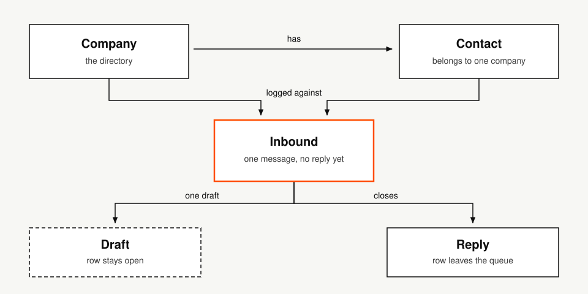
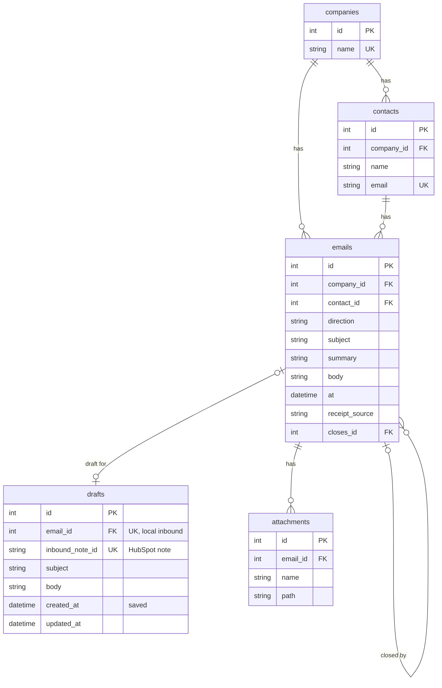

# Reply desk

Reply desk is the queue for a practice's client email. It shows who is waiting for a reply, and when that reply is due. One person signs in and works that queue.

Case study: [automica.io/reply-desk](https://automica.io/reply-desk)

A client email starts a clock. This practice is due to reply 24 hours after the clock starts. The person using the desk can set a different interval. The practice window is Monday to Friday, 08:00 to 20:00 Europe/London. Inside that window, the clock starts when the email arrives. Mail that arrives in the evening or at the weekend starts at 08:00 on the next working morning, so overnight waiting is not counted as time the practice had to answer. The due time is calculated when the queue is opened. It is not stored, so an old reading cannot linger.

The reply is sent from this screen, or sent from Mail and then marked sent here. A draft can sit on the row while the reply is written. The draft does not stop the clock. Sending, or marking sent, takes the row off the queue. What has already been answered stays on History, each message in the order it was sent.

The person who answers the mail opens that queue and sees who is waiting, and whether the reply is late on the practice's own clock. They write on the row. The next time they open that client, the last answer is already on History.

The client receives the reply within the 24 hours this practice set. A practice that answers in its own time keeps the next instruction. A late reply is late on that clock, and it shows on the queue while there is still time to send it. The time saved is the time that used to go on working out who was waiting.

Filament is the screen. Companies and contacts are read from HubSpot, or from local tables when HubSpot is not connected. The desk can add a company or a contact. When HubSpot is connected, that write goes to HubSpot. Otherwise it is stored in the local tables. A search that is not exactly one match stops. On the live desk, what arrived and what was sent is stored as a HubSpot note. The seeded copy uses the local tables.

[](https://github.com/iammikek/reply-desk/actions/workflows/tests.yml)

## Contents

- [What the queue shows](#what-the-queue-shows)
- [Run the desk](#run-the-desk)
- [Where the panel lives](#where-the-panel-lives)
- [Local record](#local-record)
- [Persistent database](#persistent-database)
- [Live desk](#live-desk)
- [Commands](#commands)
- [MCP](#mcp)
- [Tests](#tests)

## What the queue shows

Each open row is one client email, stored as an inbound clock note, with no reply sent yet.

- Client, shown as company and contact
- Summary
- Inbound time
- Clock start
- Reply due
- A draft, when one is saved

Due time is calculated when the page or a command runs. It is not stored. This practice is due to reply 24 hours after the clock starts. The person using the desk can set a different interval. The practice window is Monday to Friday, 08:00 to 20:00 Europe/London. Inside that window, the clock starts at receipt. Outside it, including the weekend, the clock starts at 08:00 on the next working day.

The desk can send a reply. Mark sent records a reply that already went from Mail. A draft does not stop the clock.

Seed the desk with `./vendor/bin/sail artisan db:seed` while `REPLY_DESK_STORE` is `memory`. The command refuses to run when the store is HubSpot. The seed loads three stand-in companies: one overdue row, one open row, a draft on the overdue row, and one closed thread.

Tests are `./vendor/bin/sail composer test`, in the Tests section below.

## Run the desk

Sail runs the desk in Docker, on PHP 8.4. The database is MySQL in that same Compose file. The container sets `REPLY_DESK_STORE=memory`, so the copy needs no HubSpot token and no real names. Docker has to be running. PHP does not need to be installed on the host.

```bash
cp .env.example .env
docker run --rm \
    -u "$(id -u):$(id -g)" \
    -v "$(pwd):/var/www/html" \
    -w /var/www/html \
    laravelsail/php84-composer:latest \
    composer install --ignore-platform-reqs
./vendor/bin/sail up -d
./vendor/bin/sail artisan key:generate
./vendor/bin/sail artisan migrate
./vendor/bin/sail artisan db:seed
```

`APP_PORT=8000` in `.env` publishes the app at [http://localhost:8000](http://localhost:8000). The seed creates the user `admin@example.com`. The password is in `database/seeders/DatabaseSeeder.php`. The panel shows Administrator.

`./vendor/bin/sail stop` stops the containers. `./vendor/bin/sail artisan` runs a command inside the app container.

## Where the panel lives

The site is the Filament panel. Sign-in is at `/login`.

- `app/Filament/Resources/Companies/CompanyResource.php` lists companies. The page reads HubSpot or the local `companies` table, whichever store is plugged in. New company adds a company on that store. A company page lists the contacts on that company, and New contact adds one. There is no edit.
- `app/Filament/Resources/Contacts/ContactResource.php` lists contacts from that same directory. New contact adds a name and an email on one company.
- `app/Filament/Resources/Inbounds/InboundResource.php` is the open queue and History. The open list is the panel home. A count shows how many rows are open, and how many are overdue. Each row is one client email. There is no create and no edit for a message.
- `app/Filament/Tables/OpenRepliesTable.php` is the open table, the overdue filter, and the row actions
- `app/Filament/Widgets/OpenQueueOverview.php` counts open and overdue rows
- `app/Providers/Filament/AdminPanelProvider.php` registers the panel

Log inbound, save a draft, discard a draft, send, and mark sent are actions on the queue.

History lists closed threads, newest sent time first, ten at a time. A company with nothing open is on that page. Thread opens a timeline: the client email first, then each reply in the order it was sent.

## Local record

Companies and Contacts are Filament resources. Each reads the store that is plugged in. HubSpot supplies the rows when `REPLY_DESK_STORE` is `hubspot`. The tables below supply them when it is not. The screen is the same either way. New company and New contact write to that same store. A search that is not exactly one match stops.

Clock start and reply due are calculated when the page or a command runs. They are not stored, and they are left off this diagram.





A company has many contacts and many emails. A contact belongs to one company, and the email is stored in lowercase. An email is one message, inbound or outbound, and it belongs to one company and one contact. `at` is the receipt time or the time the reply was sent. `receipt_source` is `mail client`, `logged`, or `whatsapp` on an inbound, and empty on an outbound. `whatsapp` is a pasted message. The desk does not connect to WhatsApp. `closes_id` points at the inbound an outbound closes. It is empty when Mike wrote first. One inbound may have several replies. The same sent minute on that inbound is refused.

A draft is the unsent reply for one open inbound. `email_id` points at the local email. `inbound_note_id` points at the HubSpot note. A row has one of those, not both. Saving a draft does not close the inbound. Marking the reply sent deletes the draft. An attachment is a file on one email.

The memory store reads and writes these tables. `fake_parties` and `fake_notes` are gone. A draft on that store uses `email_id`. A draft on the HubSpot store uses `inbound_note_id`.

## Persistent database

Login, sessions, and the company-list cache are Laravel tables. The local record above is the companies, contacts, emails, drafts, and attachments. With HubSpot plugged in, companies, contacts, and clock notes stay in HubSpot, and a draft keeps the HubSpot note id.

The desk keeps those Laravel tables in MySQL. The Compose file starts that server and sets these values on the app container, matching `.env.example`:

```
DB_CONNECTION=mysql
DB_HOST=mysql
DB_PORT=3306
DB_DATABASE=reply_desk
DB_USERNAME=sail
DB_PASSWORD=password
```

`DB_HOST` is the Compose service name. From a client on the host, the published port is 3306. `./vendor/bin/sail artisan migrate` creates the tables. Do not commit `.env`.

Leave this in `.env` when running the desk:

```
REPLY_DESK_STORE=memory
```

## Live desk

Set `REPLY_DESK_STORE=hubspot`, `HUBSPOT_ACCESS_TOKEN`, and `HUBSPOT_PORTAL_ID`. A write stops unless the token's portal matches `HUBSPOT_PORTAL_ID`. The token stays in `.env` and is never printed.

`./vendor/bin/sail artisan reply:backfill {path}` prints the open rows and the sent rows. A sent row is an inbound note plus the sent note that closes it. A row with no clock time, or no email address, is skipped. A date with no time is skipped. The desk does not invent a time. A Client email or Reply link is copied onto the note, and an unsent reply becomes the draft, so the queue can be read away from the files. It writes only with `--write`, and only when the store is HubSpot and a portal id is set.

The file has an Open table and a Sent table. Client is the company and the contact. Inbound starts with the receipt, then the summary. Reply sent stays empty while the row is open. The address sits in Attachment. A link labelled Client email or Reply is a file beside the table.

```markdown
# Communications

## Open

| Client | Inbound | Clock start | Reply due | Reply sent | Attachment |
| --- | --- | --- | --- | --- | --- |
| Northwharf Bakery / Ada North | 20 Oct 2026 10:00. Which PHP to use. | 20 Oct 2026 10:00 | 21 Oct 2026 10:00 |  | [Client email](./emails/ada.md). [Reply](./emails/ada-draft.md). ada@northwharf.example |

## Sent

| Client | Inbound | Clock start | Reply due | Reply sent | Attachment |
| --- | --- | --- | --- | --- | --- |
| Harbour Cafe / Ned Shore | 22 Oct 2026 11:00. Menu for the weekend. | 22 Oct 2026 11:00 | 23 Oct 2026 11:00 | 22 Oct 2026 16:00 | [Reply](./emails/ned-reply.md). Subject Weekend menu. ned@harbour.example |
```

A linked reply names the subject, then the body:

```markdown
**Subject:** Weekend menu

## Body

The Saturday menu can go out on Friday.
```

## Commands

The same actions the panel uses:

```bash
./vendor/bin/sail artisan reply:list-open
./vendor/bin/sail artisan reply:list-closed
./vendor/bin/sail artisan reply:directory
./vendor/bin/sail artisan reply:create-company {name}
./vendor/bin/sail artisan reply:create-contact {company} {name} {email}
./vendor/bin/sail artisan reply:log-inbound {company} {email} {receipt} {source} {summary} {client?} {--subject=}
./vendor/bin/sail artisan reply:save-draft {inbound} {subject} {body}
./vendor/bin/sail artisan reply:discard-draft {inbound}
./vendor/bin/sail artisan reply:mark-sent {inbound} {sent} {reply?} {--subject=}
```

`receipt`, `sent`, and `--now` are `Y-m-d H:i` in Europe/London. `source` is `mail client`, `logged`, or `whatsapp`. `--subject` on an inbound is the client email subject, one line, and it is omitted when the paste has none. `--subject` on a reply is omitted when the reply has none. The desk then keeps the subject of the previous message. A later reply at a different minute is another sent note on that inbound. The same minute is refused.

## MCP

The panel on port 8000 does not expose the MCP. The client starts the stdio process itself. A copy already running from `npm run mcp` in a terminal cannot be attached.

Cursor and Claude load the same `reply-desk` entry inside `mcpServers`. Each client keeps that object in its own MCP configuration. The entry has to sit inside that object. Pasting it after the closing brace leaves the file invalid and the client will not load the server.

```json
"reply-desk": {
  "command": "node",
  "args": ["mcp-server/index.mjs"],
  "cwd": "/absolute/path/to/reply-desk",
  "env": {
    "PATH": "/path/to/php/bin:/usr/bin:/bin",
    "PHP_BINARY": "/path/to/php"
  }
}
```

The panel runs in Docker. These tools call `php artisan` on the machine that starts the client. Set `PHP_BINARY` when that binary is not on `PATH`. The process reads the HubSpot token from this project's `.env`. The token does not go in the MCP configuration.

Ask in plain language, for example "list the open replies". The client calls the tool and asks for approval. The tools are `list_companies`, `create_company`, `create_contact`, `list_open_replies`, `list_closed_replies`, `log_inbound`, `save_draft`, `discard_draft`, and `mark_reply_sent`. `list_companies` is the cached company and contact list. `create_company` and `create_contact` add a row on that list. A company or contact already there is refused. `log_inbound` records a client email against one of those contacts, and it can keep the subject. `mark_reply_sent` records a reply that already went from Mail. A reply with no subject keeps the subject of the previous message. A later reply at a different minute is another message on that inbound. The same minute is refused. There is no send tool. The process shells to the Artisan commands. It does not talk to HubSpot itself.

## Tests

```bash
./vendor/bin/sail composer test
```

That runs the Pest suite inside the app container. One test starts the MCP server and checks the tool list. The suite uses the memory store and recorded HubSpot responses. It does not call a live portal.

GitHub Actions runs the same command on every push and pull request: [`.github/workflows/tests.yml`](.github/workflows/tests.yml). The job uses PHP 8.4 and Node 22.
