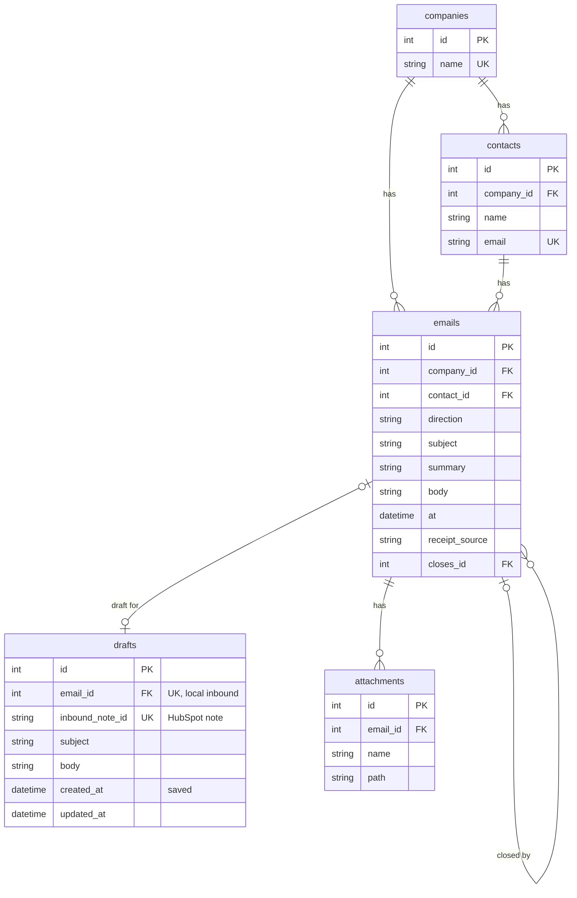

# Reply desk

Reply desk is the queue for a practice's client email. It shows who is waiting for a reply, and when that reply is due. One person signs in and works that queue.

A client email starts a clock. The reply is due 24 hours after the clock starts. From Monday to Friday, 08:00 to 20:00 Europe/London, the clock starts when the email arrives. Mail that arrives in the evening or at the weekend starts at 08:00 on the next working morning, so overnight waiting is not counted as time the practice had to answer. The due time is calculated when the queue is opened. It is not stored, so an old reading cannot linger.

The reply is sent from this screen, or sent from Mail and then marked sent here. A draft can sit on the row while the reply is written. The draft does not stop the clock. Sending, or marking sent, takes the row off the queue. What has already been answered stays on History, each message in the order it was sent.

The person who answers the mail opens that queue and sees who is waiting, and whether the reply is late on the practice's own clock. They write on the row. The next time they open that client, the last answer is already on History.

The client receives the reply inside the window the practice set. A practice that answers inside that window keeps the next instruction. A late reply shows on the queue while there is still time to send it. The time saved is the time that used to go on working out who was waiting.

Filament is the screen. Companies and contacts come from HubSpot, or from local stand-in tables when HubSpot is not connected. On the live desk, what arrived and what was sent is stored as a HubSpot note. The copy that can be shown uses those local tables, with no token and no real names.

[](https://github.com/iammikek/reply-desk/actions/workflows/tests.yml)

## What the queue shows

Each open row is one client email, stored as an inbound clock note, with no reply sent yet.

- Client, shown as company and contact
- Summary
- Inbound time
- Clock start
- Reply due
- A draft, when one is saved

Due time is calculated when the page or a command runs. It is not stored. Monday to Friday, 08:00 to 20:00 Europe/London, the clock starts at receipt and the reply is due 24 hours later. Outside that window, including the weekend, the clock starts at 08:00 on the next working day.

The desk can send a reply. Mark sent records a reply that already went from Mail. A draft does not stop the clock.

Seed the showable copy with `php artisan db:seed` while `REPLY_DESK_STORE` is `memory`. The command refuses to run when the store is HubSpot. The seed loads two stand-in companies, one overdue row and one open row, and a draft on the overdue row.

Tests are `composer test`, in the Tests section below.

## Run the showable copy

The memory store needs no HubSpot token and no real names. Send delivers the reply through the configured mailbox.

```bash
composer install
cp .env.example .env
php artisan key:generate
touch database/database.sqlite
php artisan migrate
php artisan db:seed
npm install
php artisan serve
```

Sign in as `admin@example.com`. The panel shows Administrator.

## Sail

Sail runs that same showable copy in Docker, on PHP 8.4. The container uses the SQLite file and `REPLY_DESK_STORE=memory`, so a `.env` that points at HubSpot or Supabase is left untouched. Docker has to be running.

```bash
composer install
cp .env.example .env
php artisan key:generate
touch database/database.sqlite
./vendor/bin/sail up -d
./vendor/bin/sail artisan migrate
./vendor/bin/sail artisan db:seed
```

`APP_PORT=8000` in `.env` publishes the app at [http://localhost:8000](http://localhost:8000). The seed creates the user `admin@example.com`. The password is in `database/seeders/DatabaseSeeder.php`. The panel shows Administrator.

`./vendor/bin/sail stop` stops the container. `./vendor/bin/sail artisan` runs a command inside it.

## Where the panel lives

The site is the Filament panel. Sign-in is at `/login`. A case study at `/case-study` explains why the desk is useful, and lists the features. It is open without a sign-in.

- `app/Filament/Resources/Companies/CompanyResource.php` lists companies. The page reads HubSpot or the local `companies` table, whichever store is plugged in. It has `form()`, `table()`, and a contacts relation manager. There is no create and no edit.
- `app/Filament/Resources/Contacts/ContactResource.php` lists contacts from that same directory
- `app/Filament/Resources/Inbounds/InboundResource.php` is the open queue and History. It has `form()`, `table()`, and a replies relation manager. The open list is the panel home. There is no create and no edit.
- `app/Filament/Tables/OpenRepliesTable.php` is the open table, the overdue filter, and the row actions
- `app/Filament/Widgets/OpenQueueOverview.php` counts open and overdue rows
- `app/Providers/Filament/AdminPanelProvider.php` registers the panel

Log inbound, save a draft, discard a draft, send, and mark sent are actions on the queue.

History lists closed threads, newest sent time first, ten at a time. A company with nothing open is on that page. Thread opens a timeline: the client email first, then each reply in the order it was sent.

## Local record

Companies and Contacts are Filament resources. Each reads the store that is plugged in. HubSpot supplies the rows when `REPLY_DESK_STORE` is `hubspot`. The tables below supply them when it is not. The screen is the same either way. The desk creates no company and no contact. A match that is not exactly one stops.

Clock start and reply due are calculated when the page or a command runs. They are not stored.



A company has many contacts and many emails. A contact belongs to one company, and the email is stored in lowercase. An email is one message, inbound or outbound, and it belongs to one company and one contact. `at` is the receipt time or the time the reply was sent. `receipt_source` is `mail client`, `logged`, or `whatsapp` on an inbound, and empty on an outbound. `whatsapp` is a pasted message. The desk does not connect to WhatsApp. `closes_id` points at the inbound an outbound closes. It is empty when Mike wrote first. One inbound may have several replies. The same sent minute on that inbound is refused.

A draft is the unsent reply for one open inbound. `email_id` points at the local email. `inbound_note_id` points at the HubSpot note. A row has one of those, not both. Saving a draft does not close the inbound. Marking the reply sent deletes the draft. An attachment is a file on one email.

The memory store reads and writes these tables. `fake_parties` and `fake_notes` are gone. A draft on that store uses `email_id`. A draft on the HubSpot store uses `inbound_note_id`.

## Persistent database

Login, sessions, and the company-list cache are Laravel tables. The local record above is the companies, contacts, emails, drafts, and attachments. With HubSpot plugged in, companies, contacts, and clock notes stay in HubSpot, and a draft keeps the HubSpot note id.

The showable copy uses SQLite. The running desk uses Supabase Postgres in an EU region. Copy the direct connection from the Supabase dashboard into `.env`:

```
DB_CONNECTION=pgsql
DB_HOST=db.YOUR_PROJECT_REF.supabase.co
DB_PORT=5432
DB_DATABASE=postgres
DB_USERNAME=postgres
DB_PASSWORD=
DB_SSLMODE=require
```

Use port 5432. The transaction pooler on port 6543 breaks Laravel migrations. The direct host is IPv6-only, so from this Mac use the session pooler and set `DB_USERNAME` to `postgres.YOUR_PROJECT_REF`.

Then run `php artisan migrate`. Do not commit `.env`.

Leave these in `.env` for the showable copy:

```
REPLY_DESK_STORE=memory
```

## Live desk

Set `REPLY_DESK_STORE=hubspot`, `HUBSPOT_ACCESS_TOKEN`, and `HUBSPOT_PORTAL_ID`. A write stops unless the token's portal matches `HUBSPOT_PORTAL_ID`. The token stays in `.env` and is never printed.

`php artisan reply:backfill {path}` prints the open rows and the sent rows. A sent row is an inbound note plus the sent note that closes it. A row with no clock time, or no email address, is skipped. A Client email or Reply link is copied onto the note, and an unsent reply becomes the draft, so the queue can be read away from the files. It writes only with `--write`, and only when the store is HubSpot and a portal id is set.

## Commands

The same actions the panel uses:

```bash
php artisan reply:list-open
php artisan reply:list-closed
php artisan reply:directory
php artisan reply:log-inbound {company} {email} {receipt} {source} {summary} {client?}
php artisan reply:save-draft {inbound} {subject} {body}
php artisan reply:discard-draft {inbound}
php artisan reply:mark-sent {inbound} {sent} {subject} {reply}
```

`receipt`, `sent`, and `--now` are `Y-m-d H:i` in Europe/London. `source` is `mail client`, `logged`, or `whatsapp`.

## Cursor

The panel on port 8000 does not expose the MCP. Cursor starts the stdio process itself. A copy already running from `npm run mcp` in a terminal cannot be attached.

Add `reply-desk` inside `mcpServers` in `~/.cursor/mcp.json`. The entry has to sit inside that object. Pasting it after the closing brace leaves the file invalid and Cursor will not load the server.

```json
"reply-desk": {
  "command": "node",
  "args": ["mcp-server/index.mjs"],
  "cwd": "/absolute/path/to/reply-desk",
  "env": {
    "PATH": "/path/to/php/bin:/usr/bin:/bin",
    "PHP_BINARY": "/path/to/php"
  }
}
```

`PHP_BINARY` is the Herd PHP on this Mac, so the server can run `php artisan`. The process reads the HubSpot token from this project's `.env`. The token does not go in `mcp.json`.

Open the Agents sidebar, the one that lists chats. **Customize** is under that list. It is not in the file explorer. Open **Customize**, then **MCPs**, and turn **reply-desk** on. If that sidebar is hidden, press **Cmd+Shift+J** and open MCP from Cursor Settings. When the tools appear, start a new Agent chat.

Ask in plain language, for example "list the open replies". Cursor calls the tool and asks for approval. The tools are `list_companies`, `list_open_replies`, `list_closed_replies`, `log_inbound`, `save_draft`, `discard_draft`, and `mark_reply_sent`. `list_companies` is the cached company and contact list. `log_inbound` records a client email against one of those contacts. There is no send tool. The process shells to the Artisan commands. It does not talk to HubSpot itself.

## Tests

```bash
composer test
```

That runs the Pest suite. One test starts the MCP server and checks the tool list. The suite uses the memory store and recorded HubSpot responses. It does not call a live portal.

GitHub Actions runs the same command on every push and pull request: [`.github/workflows/tests.yml`](.github/workflows/tests.yml). The job uses PHP 8.4 and Node 22.
