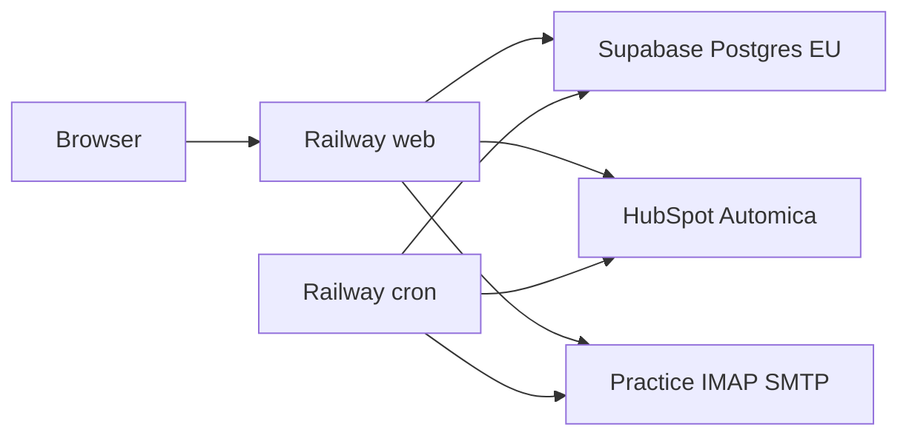

# Deploy (Railway)

Live practice desk on **Railway Hobby**: HubSpot store, existing Supabase EU Postgres, practice IMAP/SMTP. Not the Sail/memory showable copy. Not Krystal cPanel (PHP 8.4, secrets UI, and the every-minute mailbox scheduler fit Railway; they fight shared hosting).

## Services

Same GitHub repo, two Railway services (no Sail, no Compose):

| Service | Role | Deploy settings |
| --- | --- | --- |
| **web** | Filament HTTPS | Railpack/Caddy + FrankenPHP. Pre-deploy: `chmod +x railway/init-app.sh && ./railway/init-app.sh` (migrate, `filament:assets`, config/route/view caches) |
| **cron** | Scheduler | Custom start: `chmod +x railway/run-cron.sh && ./railway/run-cron.sh` (`schedule:work` → `reply:poll-mailbox` every minute) |

Give only **web** a public domain. Cron shares the same variables; it must not run `init-app.sh` as its start command.

Build uses Railpack (PHP from `composer.json` ^8.4) with document root `/app/public`. Railpack runs `composer install --no-scripts`, so Filament’s published files under `public/css|js|fonts/filament` are **committed** (not gitignored) and refreshed with `php artisan filament:assets`. Vite assets: `npm run build` during the image build; [`.npmrc`](../.npmrc) keeps build tooling installable under production npm. CI runs `filament:assets` and `npm run build` before the Railway gate.

## Database

Use the **existing Supabase** project (session pooler **`:5432`**, not transaction `:6543`). Do not add Railway Postgres for this pass.

`php artisan migrate --force` runs from `railway/init-app.sh` on each web deploy. **Do not** re-run the database seeder on live (it would reset the administrator).

## Environment variables

Set these in the Railway variables UI for **both** services (raw editor is fine). Never commit secrets.

| Variable | Notes                                                                       |
| --- |-----------------------------------------------------------------------------|
| `APP_NAME` | `Reply desk`                                                                |
| `APP_ENV` | `production`                                                                |
| `APP_DEBUG` | `false`                                                                     |
| `APP_KEY` | From `php artisan key:generate --show` locally; same value on both services |
| `APP_URL` | Public HTTPS URL of the web service                                         |
| `LOG_CHANNEL` | `stderr`                                                                    |
| `LOG_STDERR_FORMATTER` | `\Monolog\Formatter\JsonFormatter`                                          |
| `DB_CONNECTION` | `pgsql`                                                                     |
| `DB_HOST` | Supabase session pooler host                                                |
| `DB_PORT` | `5432`                                                                      |
| `DB_DATABASE` | Supabase database name                                                      |
| `DB_USERNAME` | Pooler user                                                                 |
| `DB_PASSWORD` | Pooler password                                                             |
| `DB_SSLMODE` | `require` (typical for Supabase)                                            |
| `SESSION_DRIVER` | `database`                                                                  |
| `CACHE_STORE` | `database`                                                                  |
| `QUEUE_CONNECTION` | `sync` (no separate worker on Hobby)                                        |
| `REPLY_DESK_STORE` | `hubspot`                                                                   |
| `REPLY_DESK_TIMEZONE` | `Europe/London`                                                             |
| `HUBSPOT_ACCESS_TOKEN` | Your portal token                                                           |
| `HUBSPOT_PORTAL_ID` | Must match the token’s portal                                               |
| `HUBSPOT_API_BASE` | `https://api.hubapi.com`                                                    |
| `REPLY_DESK_MAILBOX_*` / `REPLY_DESK_IMAP_*` / `REPLY_DESK_SMTP_*` | Practice mailbox; omit to leave poll idle                                   |
| `MAIL_*` | Password-reset mailer (`log` until real SMTP is ready)                      |

Trust proxies are enabled in [bootstrap/app.php](../bootstrap/app.php) so HTTPS behind Railway works with `APP_URL`.

## Live project

Railway project **reply-desk** (Hobby): services **web** and **cron**. Public URL:

- Desk: https://web-production-37a11.up.railway.app/login

Filament path is `/login` (panel root is empty). Cron has no public domain.

`composer.json` declares `ext-intl`, `ext-zip`, and `ext-pdo_pgsql` so Railpack installs them before `composer install`.

## CI deploy (master)

Default branch is **`master`** (not `main`).

Both Railway services are connected to `iammikek/reply-desk` on **`master`**, with **Wait for CI** on. Flow:

1. PR merges (or push) to `master`.
2. [`.github/workflows/tests.yml`](../.github/workflows/tests.yml) runs `npm run build`, Pint, and Pest; the `railway` job records that the gate passed.
3. When that workflow succeeds, Railway builds a **new filesystem** from that commit (including Vite `npm run build`) and deploys **web** (pre-deploy `railway/init-app.sh`). **cron** gets the same commit (`railway/run-cron.sh`).
4. If tests or the asset build fail, Railway skips the deploy.

Do not also wire a GitHub Actions `railway up` with a project token while Wait for CI is on — that would double-deploy. Manual `railway up` from a laptop remains fine for emergency hotfixes.

## Bring-up checklist

1. Merge or deploy from a branch that includes this recipe (and any open desk PRs you need live).
2. Create a Railway project; link the GitHub repo (or `railway up` from a linked local tree).
3. Add the **web** service; set variables; set pre-deploy to `init-app.sh`; generate a domain; set `APP_URL` to that domain; redeploy.
4. Add the **cron** service from the same repo; same variables; custom start `run-cron.sh`; no public domain.
5. Open the HTTPS URL → Filament login; sign in as the live administrator.
6. Confirm Activity / Mailbox shows scheduled polls without a laptop (`reply:poll-mailbox`).

## Out of scope

Showable/demo deploy, moving off Supabase, a second practice, Krystal File Manager secrets, a dedicated queue worker.
