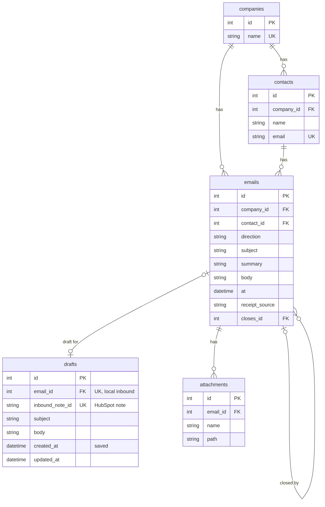

# Local record

Companies and contacts come from HubSpot when `REPLY_DESK_STORE` is `hubspot`, and from the tables below when it is not. The screen is the same either way. See [Local record](../README.md#local-record) in the README for the short version.

Clock start and reply due are calculated when the page or a command runs. They are not stored, and they are left off this diagram.

A company has many contacts and many emails. A contact belongs to one company, and the email is stored in lowercase. An email is one message, inbound or outbound, and it belongs to one company and one contact. `at` is the receipt time or the time the reply was sent. `receipt_source` is `mail client`, `logged`, or `whatsapp` on an inbound, and empty on an outbound. `whatsapp` is a pasted message. The desk does not connect to WhatsApp. `closes_id` points at the inbound an outbound closes. It is empty when the practice wrote first. One inbound may have several replies. The same sent minute on that inbound is refused.

A draft is the unsent reply for one open inbound. `email_id` points at the local email. `inbound_note_id` points at the HubSpot note. A row has one of those, not both. Saving a draft does not close the inbound. Marking the reply sent deletes the draft. An attachment is a file on one email.

The memory store reads and writes these tables. A draft on that store uses `email_id`. A draft on the HubSpot store uses `inbound_note_id`.
