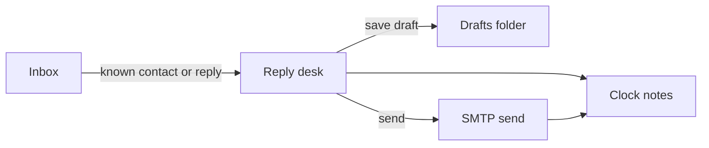

# Mailbox

Optional IMAP and SMTP for the practice account. Configure connection secrets in `.env`; control polling in the panel. See [Mailbox](../README.md#mailbox) in the README for the short version.

## Connection

Set `REPLY_DESK_IMAP_*`, `REPLY_DESK_SMTP_*`, and `REPLY_DESK_MAILBOX_FROM` in `.env`. When those are empty, drafts stay local and send uses the Laravel mailer. Credentials are not edited in the panel.

## Polling

`reply:poll-mailbox` runs every minute from the scheduler. It no-ops when the mailbox is not configured, polling is disabled, or the interval has not elapsed. **Poll now** on the Mailbox page forces a run.

Rules:

- Read Inbox since the last cursor; do not delete or move mail
- When inbox UIDVALIDITY changes, the cursor resets and the inbox is read from the start
- From must be exactly one known contact; unknown and own From are skipped
- Duplicate Message-ID skipped
- Date missing or unusable skipped (no invented midnight)
- Body is the latest message only (`ExtractLatestMessage`); quoted trails are not stored
- Receipt source is `mail client`
- Failed polls do not advance `last_polled_at`, so the schedule retries on the next tick

## Message-IDs

`mail_message_ids` maps a Message-ID to a note id (inbound or sent). Send through the practice mailbox stores the sent Message-ID and appends a copy to the Sent folder. Poll uses that for dedupe and to recognise replies via In-Reply-To / References.

## Activity

`desk_activity` is an append-only event log (poll, draft, send, inbound). The Activity page lists newest first. It is not Laravel Auditing.
