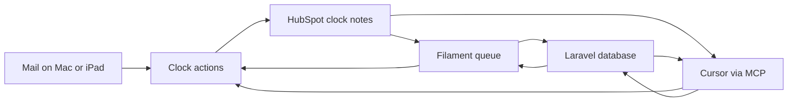

# Reply desk

The open queue for practice client email. Filament is the screen. Cursor uses the same actions through MCP. HubSpot clock notes are the record of what arrived and what was sent.

**Language:** British English in the app, the MCP text, and these docs. No emoji. No em dashes.

**Practice rules:** Automica's own HubSpot portal only, `145255358`. A note is the progress line. The desk invents no CRM properties and no email addresses. A draft is not a reply. Administrator can send the reply from the desk, or send it from Mail and mark it sent. A file on a note is uploaded to HubSpot and stored on that note. Cursor cannot send. FreeAgent and Jira stay the systems they already are. This desk does not read them.

---

## 1. Purpose

The live record used to be a table in `automica-public` at `docs/client-communications.md`. Due time was calculated when someone read the file. A stale elapsed time is still never stored.

That file is now the archive. New receipts and sent replies go through the actions. Both the panel and Cursor call those actions. The actions write clock notes to HubSpot.

## 2. Who uses it

| User | What they do |
| --- | --- |
| Administrator | Opens the queue, sees who is waiting and when the reply is due, logs an inbound, saves a draft, sends a reply, or marks a reply sent after it went from Mail. |
| Cursor | Lists companies, logs an inbound, saves a draft, discards a draft, and marks a reply sent, through the same actions as the panel. |

One user. The panel is not a client login. Sign in as `admin@example.com`.

## 3. The queue

Each open row is an inbound clock note with no sent note pointing at it.

- Client, shown as company and contact
- Summary
- Inbound time
- Clock start
- Reply due
- A draft, when one is saved for that row

Due time is calculated when the page or a tool runs. It is not stored.

A filter shows rows whose reply is overdue. Marking a reply sent fills the sent time and the row leaves the queue.

Closed threads for the same company also appear on an open row as "Earlier on this client": the receipt, the summary, the client email, and each reply in sent order. The History page lists closed threads, newest sent time first, ten at a time, including a company that has nothing open. Opening a thread shows a timeline: the client email, then each reply in sent order. The client name on History and the open queue opens that client's page: every inbound and reply for that company and contact, in time order, including a row that is still open.



## 4. Where the data lives

Clock notes stay in HubSpot when that store is plugged in. Companies and contacts are read from the same store as the notes: HubSpot, or the local tables when HubSpot is not plugged in. A HubSpot write stops unless the token's portal is `145255358`. The token is never printed and never committed.

Login, sessions, drafts, and the cache are Laravel tables. On the running desk those tables are Supabase Postgres in an EU region, through the session pooler on port 5432. The direct database host is IPv6-only from this Mac. The transaction pooler on port 6543 breaks Laravel migrations. The database password stays in `.env`.

The showable copy uses SQLite and the local tables below. It has no token and no real names. That is the copy that can be opened without HubSpot.

### Local tables

These tables are the record when HubSpot is not plugged in. When it is plugged in, companies, contacts, and clock notes stay in HubSpot. The two stores are not synced. The Companies resource and the Contacts resource read whichever store is in use. Due time is still calculated on read and is never a column.

`companies` holds the practice clients the desk already knows. The desk still creates none from an email domain. `name` is unique. A company match is one match or it stops.

`contacts` belong to one company. `email` is unique and stored in lowercase. Logging an inbound refuses a contact who is not on the chosen company.

`emails` is one message.

| Column | Holds |
| --- | --- |
| company_id, contact_id | Who it belongs to |
| direction | `inbound` or `outbound` |
| subject | One line, empty when the paste has none |
| summary | The queue line for an inbound. A few sentences, no time |
| body | The message as pasted |
| at | Receipt time, or the time the reply was sent, Europe/London |
| receipt_source | `mail_client` or `logged` on an inbound. Empty on an outbound |
| closes_id | The inbound this outbound closes. Empty when Mike wrote first |

A second outbound at a different minute may close the same inbound. The same sent minute on that inbound is refused. An outbound with an empty `closes_id` is a first write or a later write with no new inbound. The queue line for that row stays Outreach started or Mike wrote again. Clock start and reply due are not stored.

`drafts` already stores a subject and a body. It gains `email_id`, unique, pointing at an open inbound. The HubSpot copy keeps `inbound_note_id` instead. A row has one of those, not both. One draft per open inbound. Saving it does not close the inbound and does not change the due time. Marking the reply sent deletes the draft.

`attachments` belongs to one email: the file name and the path on the local disk. The showable copy stores the file here. The live desk still uploads it to the HubSpot note.

`fake_parties` and `fake_notes` are replaced by these tables. They were a stand-in for a HubSpot note, not a record of the company, the email, and the draft.

The queue of clock notes is cached for one minute. The company and contact list is cached for one hour. Both caches store plain field arrays. A write clears the note cache. A note written or replaced here is also kept in a pending list for fifteen minutes, and every read includes it until a fresh HubSpot search returns the same id and the same body. HubSpot search is read in pages, and company and contact links are read in batches, so one queue load stays inside the ten-second call limit.

## 5. Clock

A working day is Monday to Friday, 08:00 to 20:00, Europe/London.

| Receipt | Clock start | Reply due |
| --- | --- | --- |
| Tuesday 10:00 | Tuesday 10:00 | Wednesday 10:00 |
| Thursday 21:00 | Friday 08:00 | Saturday 08:00 |
| Friday 21:00, or Saturday, or Sunday | Monday 08:00 | Tuesday 08:00 |

Received inside the window: the clock starts at receipt. The reply is due 24 hours later.

Received after 20:00, or on Saturday or Sunday: the clock starts at 08:00 on the next working day. Friday evening starts on Monday 08:00.

## 6. Clock note shape

The header is the lines before the first blank line. Ordinary progress notes stay ordinary. The reader ignores any note whose header does not match.

Inbound:

```
Clock: inbound
Receipt: 2026-10-22 10:42 Europe/London
Receipt source: mail client
Summary: Which PHP to use
```

`Receipt source` is `mail client` or `logged`. `logged` means the receipt time was not on the mail, and the time it was brought into the desk was used. Summary is one line.

Sent:

```
Clock: sent
Closes: 123456789
Sent: 2026-10-22 16:04 Europe/London
Subject: PHP on the new server
```

`Closes` is the HubSpot id of the inbound note, digits only. `Subject` is one line. A second sent note at a different minute can close the same inbound. The same sent minute is not written twice.

After a blank line, the note may carry the correspondence. A section is filled only when that section is empty.

```
Client email:
Which loaf for Friday.

Reply:
The wholemeal.
```

`Client email` is the message that arrived. `Reply` is the message that was sent, pasted from Mail. The mailbox still has the original. The sent note keeps the subject and this pasted body. A subject stays one line. The pasted body keeps its blank lines, indentation, and runs of spaces, and the timeline shows that text as pasted.

## 7. Companies and contacts

Companies is a Filament resource. Contacts is a Filament resource. Each one reads the store that is plugged in. With `REPLY_DESK_STORE=hubspot` the rows are the HubSpot companies and the HubSpot contacts. With the memory store the rows are the local `companies` and `contacts` tables. The screen is the same either way. A company page lists only the contacts on that company, from that same store.

The panel logs an inbound from that directory. Company is a searchable list of companies already on the store. Contact is a searchable list of the contacts already on that company, labelled with name and email. Choosing another company clears the contact. The desk creates no companies and no contacts.

The Artisan command and the MCP tool take the company name and the contact email from that same list. The company match is the full name, then a token match on every word of the name. The contact match is the lowercased email. Zero matches or more than one match stops, and no note is written. The contact must be on the chosen company when the panel records by id.

## 8. Actions

| Action | Does |
| --- | --- |
| `list_open_replies` | Reads clock notes. Returns inbound rows with no sent note, including clock start and reply due calculated at call time. Includes the saved draft when one exists. The draft does not change the due time. Includes earlier closed threads for the same company. |
| `list_closed_replies` | Returns inbound rows that have a sent note, newest sent time first. Includes the client email and each pasted reply. A company with nothing open is included. |
| `list_companies` | Lists companies and the contacts on each company. The list is cached for one hour. |
| `log_inbound` | Writes one inbound clock note. The panel takes a subject and a body. The command takes a one-line summary and the client email text. |
| `save_draft` | Creates or replaces the draft for an open inbound id. Arguments: subject, body. Refuses if that inbound is already closed. Writes no HubSpot note. |
| `discard_draft` | Deletes the draft for an inbound id. Writes no HubSpot note. |
| `mark_reply_sent` | Writes one sent clock note for an open inbound id. Arguments: sent time, subject, and the reply text pasted from Mail. Refuses if that inbound is already closed. Deletes any draft for that id. |

`save_draft` and `discard_draft` write no clock note. The only note that closes a row is the sent note from `mark_reply_sent`. One draft per open inbound. The draft stores the inbound note id, the subject, the body, and the time it was saved. It points at a HubSpot note id and is not itself a HubSpot note. A draft does not stop the clock.

The panel actions are Log inbound, view, save draft, discard draft, send, and mark sent. Send delivers the reply through the configured mailbox and then writes the sent note. Mark sent records a reply that already went from Mail. A file chosen on either action is uploaded to HubSpot and stored on the note.

## 9. MCP

Stdio, started by Cursor from this repo with `node mcp-server/index.mjs`. The process shells to `php artisan`. It does not hold the HubSpot token and it does not send mail. The panel on port 8000 does not expose these tools.

Register `reply-desk` inside `mcpServers` in `~/.cursor/mcp.json`, with `cwd` set to this repo and `PHP_BINARY` set so `php artisan` resolves. Cursor starts that process. A terminal copy of `npm run mcp` is not the connection.

In Cursor, **Customize** is in the Agents sidebar, under the chat list. Open **Customize**, then **MCPs**, and turn **reply-desk** on. If that sidebar is hidden, **Cmd+Shift+J** opens Cursor Settings, and MCP is in there. When the tools are listed, start a new Agent chat and ask for the action in plain language. Cursor calls the tool.

| Tool | Calls |
| --- | --- |
| `list_companies` | `reply:directory` |
| `list_open_replies` | `reply:list-open` |
| `list_closed_replies` | `reply:list-closed` |
| `log_inbound` | `reply:log-inbound` |
| `save_draft` | `reply:save-draft` |
| `discard_draft` | `reply:discard-draft` |
| `mark_reply_sent` | `reply:mark-sent` |

`receipt`, `sent`, and `--now` are `Y-m-d H:i` in Europe/London. After a write, the open queue in the panel changes because both read the same notes.

## 10. Cutover

The Open table and the sent history in `docs/client-communications.md` were imported with `reply:backfill`. The command prints the notes it would write. It writes only with `--write`, and only when the store is HubSpot and the portal is `145255358`.

Each open row became one inbound clock note. Each sent row that had a clock time and an email address became an inbound note plus the sent note that closes it. A second send at a different minute on the same receipt became another sent note on that inbound. Where the row linked a client email or a reply, that message was copied onto the note. An unsent reply became the draft.

A row with no clock time, or no email address, was skipped. A date with no time was left unimported. The desk does not invent `00:00` or `08:00` for a missing time. `logged` was used where the mail-client time was not on the original paste.

That markdown file is the archive. New receipts and sent replies go through the actions only.

## 11. Showable copy

A separate setup, with stand-in companies and `REPLY_DESK_STORE=memory`. No token, no real names, no portal id on screen. It is the Filament panel on the local tables: companies and their contacts, the open queue, a draft that leaves the row open, an overdue filter that does not load a row that is not due, History, and the thread for one contact. Send and mark sent write the outbound email and delete the draft. `php artisan db:seed` refuses to run when the store is HubSpot, and it refuses portal `145255358`. That copy is the one that can be shown.

## 12. Outside this desk

- New HubSpot properties or a second deal
- FreeAgent invoices
- DEV issues and sprints
- A client's HubSpot portal
- Supabase Auth, storage, or realtime
- Job search

A later page may read an open invoice or a DEV parent for the same company. That page is not this desk, and it does not become a second CRM.

## 13. Tests

Pest covers the clock, the note shape, the actions, the panel, the backfill, and the MCP server. The suite calls the memory store and recorded HubSpot responses. It does not call the live portal or a real mailbox. Tests use SQLite in memory.

The three rows in the clock section are one dataset. Each one checks the clock start and the reply due in Europe/London.

Note tests parse and write the inbound and sent bodies. A normal progress note is ignored. A sent note whose `Closes` id matches an inbound note removes that row from the open queue. The due time is calculated when the list runs, so it is not present in the fixture. The client email and the reply text round-trip through the correspondence sections.

Action tests use the memory note store and the draft table:

- An open list contains only inbound notes with no sent note, and the due time matches the clock.
- A saved draft is returned with that row, and the due time stays the same. Discarding it removes the text and leaves the row open.
- Mark sent closes the row, stores the pasted reply, and deletes the draft. Marking a closed row is refused.
- A company or contact search that is not exactly one match stops, and no note is written.
- A contact who is not on the chosen company is refused.
- A portal id that does not match the env value stops before any write.

Panel tests drive the Filament page through Livewire. The open row renders, the overdue filter hides a row that is not due, the note slide-over opens, and log inbound, save, discard, send, and mark sent behave as the action tests describe. Log inbound offers only the contacts on the chosen company. Send and mark sent can carry one file. Mark sent requires the pasted reply.

The MCP test starts the stdio server, checks the tool list, and logs an inbound from the directory. The backfill test uses a saved copy of the communications file. It does not pass `--write`.

GitHub Actions runs `vendor/bin/pint --test` and then `composer test` on every push and pull request, with PHP 8.4 and Node 22. A commit formats staged PHP files with Pint before they are recorded.

## 14. Still to do

Sending from the desk, a file on a new note, a file on History, pasted formatting, Pint in CI and before commit, and opening on the queue are already built. A second Filament sample is not part of this desk.

**Local record.** Build the tables in section 4, then point the memory store and the Companies and Contacts screens at them. HubSpot stays the record when that store is plugged in. The two stores are not synced. Due time stays calculated and is never a column. The desk still creates no company and no contact.

1. Add `companies`, `contacts`, `emails`, and `attachments`, and the models for them. Add nullable unique `drafts.email_id`. Make `drafts.inbound_note_id` nullable. A draft row has one of those two pointers, not both, and not neither. Existing draft rows keep their note id. `emails.closes_id` plus `emails.at` refuses the same sent minute twice. `at` is the same London minute the clock-note header uses today.
2. Point `DatabaseNoteStore` at those tables. `notes()` still returns a clock-note body built from the email, so the queue, the parser, and the actions stay. Drop `fake_parties` and `fake_notes` in the same change, and update the seed and the tests that insert them. Leave `HubSpotNoteStore` as it is.
3. On the memory store, save, list, discard, and mark sent use `drafts.email_id`. On HubSpot they keep using `drafts.inbound_note_id`. One draft per open inbound. Saving it does not close the row. Marking sent deletes it.
4. Add the Companies resource and the Contacts resource. Both list `NoteStore::directory()`, so the memory tables and HubSpot feed the same screen. No create and no edit. A company lists only the contacts on that company. A signed-out visitor cannot open either resource.
5. Seed the showable copy through the same log-inbound path, still refusing the HubSpot store and portal `145255358`. After the seed, the two stand-in companies, the open queue, the overdue row, and its draft are on the local tables.

Tests stay on SQLite and the memory store, plus the recorded HubSpot responses that already exist. Nothing in this work calls the live portal or runs `reply:backfill --write`.

**The portal id stays out of the repo.** `145255358` comes out of this plan, the README, the seed refusal text, and the backfill command. The seed still runs only on the memory store. Backfill `--write` still runs only when the store is HubSpot and a portal id is set. Tests use a stand-in id, not the live one.

**Public first screen.** The README says what the queue shows, how to seed the showable copy, and where the tests are. It says the desk can send a reply, and that mark sent records one that already went from Mail. The seed password is not on that page. Clone steps come after that screen. The current README still says the reply goes out from Mail, and it still shows the seed password and the portal id.

**The inbound is a resource.** Open queue and History become that resource and the replies that belong to it, on this panel. Companies is a resource, and Contacts is a resource. Both read the local tables or HubSpot, whichever store is plugged in. On a company, the relation manager lists the contacts on that company. Send and mark sent close the inbound. The file stays on the email it belongs to. The overdue filter runs on the query that loads the open page, and a test shows a row that is not overdue is not loaded. One administrator. A signed-out visitor cannot open an inbound, a company, a client page, or a file. Due time stays calculated and is never stored. With HubSpot plugged in, HubSpot stays the record of companies, contacts, and clock notes. Without it, the local tables are that record, and the panel reads those. The README names this Filament 5 resource and the Filament 3 words for the same pieces: `form()`, `table()`, and a relation manager.

**Follow-up sent.** A first outbound, with no client email, stays Outreach started. A later outbound on that company is Follow-up sent. The parser currently labels every `None` row Outreach started. Notes already stored as Outreach started that were follow-ups are retitled: the V8 16:00 note `532462679236` and the Boughton 10:59 note `532027260095`. Leave `532027421929`, `532331306202`, and `532338286816` as Outreach started. Do not retitle `531907011818`. A replied-on time stands on its own, with no note about who confirmed it.

**History subjects.** Where a subject narrates the reply and the filed reply is on record, the subject becomes that reply, not the paraphrase. Examples already on History: "Mike said he assumes Nick can verify this at Mailchimp", "Mike has the link and is setting up locally", and "Mike asked for a zip". Do not invent a subject or a time.
