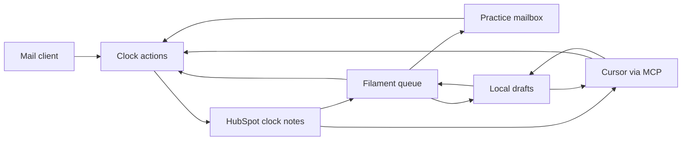

# Reply desk

Plan for the practice reply desk. Agree this before implementation. Status: plan only. Do not build until Mike says to start.

**Language:** British English in the app, the MCP text, and these docs. No emoji. No em dashes.

**Practice rules that bind this plan:** Automica's own HubSpot portal only. A note is the progress line. Do not invent extra CRM properties. A draft is not a reply. The panel can send the reply through the mailbox in the env file. The clock stops when that server accepts it, or when Mike has already sent from his mail client and marks it sent. Cursor cannot send. FreeAgent and Jira stay the systems they already are. This release does not read them.

---

## 1. Purpose

Reply desk is the open queue for practice client email.

Today that queue is a table in `automica-public` at `docs/client-communications.md`. Due time is calculated when someone reads the file. A stale elapsed time must not be stored. HubSpot already receives a progress note when a client email is logged, but the note is free text, so the queue cannot be listed from it.

The first release replaces that table as the live record. Filament is the screen Mike opens. Cursor updates the same queue through MCP. Both call one set of actions. Those actions write clock notes to HubSpot. A draft stays on this machine. It is not a clock note.

## 2. Users

| User | What they do |
| --- | --- |
| Mike | Opens the queue, sees who is waiting and when the reply is due, saves a draft, sends the reply from the row, or marks a reply sent after he has sent it from his mail client. |
| Cursor | Logs an inbound, saves a draft, and marks a reply sent through MCP, using the same actions as the panel. Cursor cannot send. |

One user. The panel is not a client login.

## 3. What the first release is

An open queue:

- Client
- Inbound time
- Clock start
- Reply due
- Sent time, blank while the row is open
- Draft, when one is saved for that row

Due time is calculated when the page or the tool runs. It is not stored.

A filter shows rows whose reply is overdue. Sending a reply from the row, or marking a reply sent, fills the sent time and the row leaves the queue.



## 4. Decisions

### 4.1 HubSpot notes hold the clock

The clock is not a new HubSpot property and not a local table of clients. The HubSpot rule is that the note is the progress line.

A clock note is a note whose body is written only by these actions, in a fixed shape. Ordinary progress notes stay ordinary. The reader ignores any note that does not match the shape.

HubSpot's own created time is when the note was written. The mail-client time, when Mike has it, is stored in the note body. If the receipt time is unknown, the note uses the time it was logged and says so.

### 4.2 One inbound, one close

Each inbound that needs a reply is one clock note. HubSpot's note id is the row id. A sent note names that id. The open queue is every inbound note that has no sent note pointing at it.

### 4.3 The panel can send the reply

`log_inbound` records that a client email arrived. `send_reply` sends one message from the row, then calls `mark_reply_sent`. `mark_reply_sent` records a reply Mike has already sent from his mail client.

The send form is a subject and a body. The To address is the contact on that inbound note. The From address is the mailbox in the env file. Laravel sends through that mailbox over SMTP. The client sees that mailbox.

The clock stops when the mail server accepts the message. That time is the sent time on the note. If the server refuses the message, there is no sent note and the row stays open. A saved draft is still there.

The send form opens with the saved subject and body when a draft exists. Sending uses the text in the form, including any edit made before send.

The mailbox keeps the body. The sent note keeps the subject. HubSpot does not send the mail. Cursor cannot call `send_reply`.

### 4.4 A draft is saved text

One draft per open inbound note. The local row stores the inbound note id, the subject, the body, and the time it was saved. It is not a HubSpot note and not a CRM property. The queue is still the HubSpot notes. This table only points at a note id.

`save_draft` creates or replaces that row for an open inbound id. `discard_draft` deletes it. `list_open_replies` includes the draft when one exists. The row stays on the queue. The due time does not change.

A draft does not stop the clock. When the server accepts a send, the draft is deleted. When `mark_reply_sent` closes the row, the draft is deleted. When the server refuses a send, the draft remains.

### 4.5 Filament reads the API

The queue uses Filament custom data (`records()`), not an Eloquent model of clients. Search, sort, and the overdue filter run on the notes just loaded. Login for the panel may use a local database. The draft table may use it. Client rows do not.

### 4.6 Cursor and the panel share the actions

Cursor does not drive Filament. A local stdio MCP server, the same shape as `automica-public-scripts`, calls `list_open_replies`, `log_inbound`, `save_draft`, `discard_draft`, and `mark_reply_sent`. It does not call `send_reply`. The HubSpot token stays in an env file and is never committed or printed.

## 5. Clock

A working day is Monday to Friday, 08:00 to 20:00, Europe/London.

| Receipt | Clock start | Reply due |
| --- | --- | --- |
| Tuesday 10:00 | Tuesday 10:00 | Wednesday 10:00 |
| Thursday 21:00 | Friday 08:00 | Saturday 08:00 |
| Friday 21:00, or Saturday, or Sunday | Monday 08:00 | Tuesday 08:00 |

Received inside the window: the clock starts at receipt. The reply is due 24 hours later.

Received after 20:00, or on Saturday or Sunday: the clock starts at 08:00 on the next working day. Friday evening starts on Monday 08:00.

Tests for this function come first, using the three rows above, before any panel or HubSpot call.

## 6. Clock note shape

Inbound:

```
Clock: inbound
Receipt: 2026-10-22 10:42 Europe/London
Receipt source: mail client
```

`Receipt source` is `mail client` or `logged`. `logged` means the receipt time was not on the mail and the time it was brought into the desk was used.

Sent:

```
Clock: sent
Closes: 123456789
Sent: 2026-10-22 16:04 Europe/London
Subject: PHP on the new server
```

`Closes` is the HubSpot id of the inbound note. `Subject` is the subject of the reply. The mailbox keeps the body. The actions are the only writers. A human progress note that happens to mention a client is not a clock note.

The note is associated with the company and the contact already on the portal. Finding them follows the existing HubSpot rule: one company match, or stop. One contact match on email, or stop. Do not invent an email address.

## 7. Actions

| Action | Does |
| --- | --- |
| `list_open_replies` | Reads clock notes, returns inbound rows with no sent note, including clock start and reply due calculated at call time. Includes the saved draft when one exists. The draft does not change the due time. |
| `log_inbound` | Writes one inbound clock note. Arguments: company, contact email, receipt time, receipt source, a one-line summary. |
| `save_draft` | Creates or replaces the local draft for an open inbound id. Arguments: subject, body. Refuses if that inbound is already closed. Writes no HubSpot note. |
| `discard_draft` | Deletes the local draft for an inbound id. Writes no HubSpot note. |
| `mark_reply_sent` | Writes one sent clock note for an open inbound id. Arguments: sent time, subject. Refuses if that inbound is already closed. Deletes any draft for that id. |
| `send_reply` | Sends one message to the contact on an open inbound note, then calls `mark_reply_sent` with the time the server accepted it. Arguments: subject, body. Refuses if that inbound is already closed. If the server refuses the message, writes nothing and leaves the draft in place. |

Filament can call all of these. MCP can call all of them except `send_reply`. `save_draft` and `discard_draft` write no clock note. `send_reply` writes no note of its own. The only note it can create is the sent note from `mark_reply_sent`.

## 8. MCP

Stdio, started by Cursor, same pattern as `yarn mcp:scripts` in automica-public.

| Tool | Calls |
| --- | --- |
| `list_open_replies` | `list_open_replies` |
| `log_inbound` | `log_inbound` |
| `save_draft` | `save_draft` |
| `discard_draft` | `discard_draft` |
| `mark_reply_sent` | `mark_reply_sent` |

The Node process shells to the PHP actions. It does not talk to HubSpot itself. It does not send mail. After a write, the open queue in the panel changes because both read the same notes.

## 9. Build order

1. Clock function and its tests.
2. Parse and write of the clock note shape, against recorded HubSpot fixtures. Tests do not call the live portal.
3. The three clock actions, still without a panel.
4. Filament page: open queue, overdue filter, mark sent.
5. Save and discard a draft. The row stays open and the due time stays the same.
6. Send from the row, using the draft when one is saved. The sent note is written only after the server accepts.
7. MCP tools over the clock actions and the draft actions. No send tool.
8. Cutover.

## 10. Cutover

Backfill whatever is in the Open table of `docs/client-communications.md` on the day of the cutover. On 23 Oct 2026 that was V8 Hosting / Lawrence Farr and Ashton Vale Pre-School / Hayley Branson. Re-read the file on the day. Do not trust this sentence if the file has moved on.

Write one inbound clock note per open row. Say `logged` where the mail-client time was not on the original paste. Leave sent history in the markdown file.

After the backfill, that markdown file is an archive. New receipts and sends go through the actions only.

## 11. Public demo

A separate copy, with stand-in companies and a fake note store. No token, no real names, no real mail. It shows the queue, the overdue filter, a saved draft, mark sent, and the send form. The send form uses the log mailer and does not deliver. Saving a draft on that copy leaves the row open. That copy is the one that can be shown. The live desk stays on Mike's machine.

## 12. Out of this release

- New HubSpot properties or a second deal
- FreeAgent invoices
- DEV issues and sprints
- A client's HubSpot portal
- Job search

A later page may read an open invoice or a DEV parent for the same company. That page is not this release, and it does not become a second CRM.

## 13. Tests

Pest covers the desk in the build order above. The suite calls a fake note store and recorded HubSpot responses. It does not call the live portal or a real mailbox.

Clock tests come first. The three rows in the clock section are one dataset. Each one checks the clock start and the reply due in Europe/London.

Note tests parse and write the inbound and sent bodies against saved HubSpot fixtures. A normal progress note is ignored. A sent note whose `Closes` id matches an inbound note removes that row. The due time is calculated when the list runs, so it is not present in the fixture.

Action tests use an in-memory note store and a local draft table:

- An open list contains only inbound notes with no sent note, and the due time matches the clock.
- A saved draft is returned with that row, and the due time stays the same. Discarding it removes the text and leaves the row open.
- Mark sent closes the row and deletes the draft. Marking a closed row is refused.
- A company or contact search that is not exactly one match stops, and no note is written.
- A portal id that does not match the env value stops before any write.
- Send addresses the contact on the row, from the mailbox in the env file. When the mailer accepts, the sent note is written and the draft is deleted. When the mailer throws, nothing is written and the draft remains.

Panel tests drive the Filament page through Livewire. The open row renders, the overdue filter hides a row that is not due, the note infolist opens, and save, discard, mark sent, and both send outcomes behave as the action tests describe.

The MCP test starts the stdio server and checks its tool list: list, log inbound, save draft, discard draft, and mark sent. There is no send tool. One tool call shells to the PHP action and returns the same row the action test already proved.

Cutover is tested against a saved copy of an Open table. The command prints the inbound notes it would write. The test does not pass `--write` and does not touch the live portal.

Before the real backfill, one manual check confirms the account info call returns portal `145255358`. On the demo copy, the same check is that the seeded queue loads, a draft saves, and the log mailer records a send without delivering it.

## 14. Done when

- The three clock cases pass.
- The open queue lists only inbound notes with no sent note, and the due time matches the clock.
- Mark sent in the panel and mark sent through MCP close the same row.
- A saved draft leaves the row open, and the due time is unchanged. The panel and MCP return the same draft.
- A send the server accepts closes that same row and deletes the draft. A send the server refuses leaves the row open and leaves the draft in place.
- The markdown log is no longer the live record.
