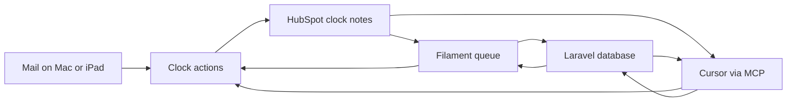
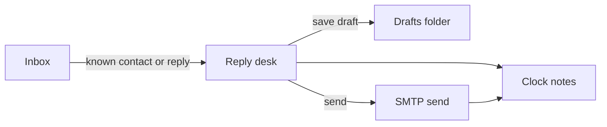

# Reply desk

The open queue for practice client email. Filament is the screen. Cursor uses the same actions through MCP. HubSpot clock notes are the record of what arrived and what was sent.

**Language:** British English in the app, the MCP text, and these docs. No emoji. No em dashes.

**Practice rules:** Automica's own HubSpot portal only. A note is the progress line. The desk invents no CRM properties and no email addresses. A draft is not a reply. Administrator can send the reply from the desk, or send it from Mail and mark it sent. A file on a note is uploaded to HubSpot and stored on that note. Cursor can send through `send_reply`. FreeAgent and Jira stay the systems they already are. This desk does not read them.

---

## 1. Purpose

The live record used to be a table in `automica-public` at `docs/client-communications.md`. Due time was calculated when someone read the file. A stale elapsed time is still never stored.

That file is now the archive. New receipts and sent replies go through the actions. Both the panel and Cursor call those actions. The actions write clock notes to HubSpot.

## 2. Who uses it

| User | What they do |
| --- | --- |
| Administrator | Opens the queue, sees who is waiting and when the reply is due, logs an inbound, saves a draft, sends a reply, or marks a reply sent after it went from Mail. |
| Cursor | Lists companies, logs an inbound, saves a draft, discards a draft, and marks a reply sent, through the same actions as the panel. |

One user. The panel is not a client login. Sign in as `admin@example.com`. Section 17 is the first sign-in password change, the profile page, and forgotten-password reset.

## 3. The queue

Each open row is an inbound clock note with no sent note pointing at it.

- Client, shown as company and contact
- Summary
- Inbound time
- Clock start
- Reply due
- A draft, when one is saved for that row

Due time is calculated when the page or a tool runs. It is not stored.

A filter shows rows whose reply is overdue. Marking a reply sent fills the sent time and the row leaves the queue.

The clock note opens as a timeline: earlier threads oldest first, then this inbound, the clock start when it is later than the receipt, and the reply due. A reply on that timeline, and on History, shows how long it took from the clock start. Only time inside the open ranges is counted, so time outside those ranges is not part of that figure. When the panel is opened outside those ranges, a banner names the next open. The reply window still lists those earlier threads above the form. The History page lists closed threads, newest sent time first, ten at a time, including a company that has nothing open. Opening a thread shows a timeline: the client email, then each reply in sent order. The client name on History and the open queue opens that client's page: every inbound and reply for that company and contact, in time order, including a row that is still open. Open queue and History are one Filament resource: `form()`, `table()`, and a relation manager for the replies that close the inbound. The open list is the panel home. Due time is calculated when that list loads. A row that is not overdue is not in the loaded set when the overdue filter is on.



## 4. Where the data lives

Clock notes stay in HubSpot when that store is plugged in. Companies and contacts are read from the same store as the notes: HubSpot, or the local tables when HubSpot is not plugged in. A HubSpot write stops unless the token's portal matches `HUBSPOT_PORTAL_ID`. The token is never printed and never committed.

Login, sessions, drafts, and the cache are Laravel tables. On the running desk those tables are Supabase Postgres in an EU region, through the session pooler on port 5432. The direct database host is IPv6-only from this Mac. The transaction pooler on port 6543 breaks Laravel migrations. The database password stays in `.env`.

The showable copy uses SQLite and the local tables below. It has no token and no real names. That is the copy that can be opened without HubSpot.

### Local tables

These tables are the record when HubSpot is not plugged in. When it is plugged in, companies, contacts, and clock notes stay in HubSpot. The two stores are not synced. The Companies resource and the Contacts resource read whichever store is in use. Due time is still calculated on read and is never a column.

`companies` holds the practice clients the desk already knows. The desk still creates none from an email domain. `name` is unique. A company match is one match or it stops.

`contacts` belong to one company. `email` is unique and stored in lowercase. Logging an inbound refuses a contact who is not on the chosen company.

`emails` is one message.

| Column | Holds |
| --- | --- |
| company_id, contact_id | Who it belongs to |
| direction | `inbound` or `outbound` |
| subject | One line, empty when the paste has none |
| summary | The queue line for an inbound. A few sentences, no time |
| body | The message as pasted |
| at | Receipt time, or the time the reply was sent, Europe/London |
| receipt_source | `mail client`, `logged`, or `whatsapp` on an inbound. Empty on an outbound |
| closes_id | The inbound this outbound closes. Empty when Mike wrote first |

A second outbound at a different minute may close the same inbound. The same sent minute on that inbound is refused. An outbound with an empty `closes_id` is a first write or a later write with no new inbound. The queue line for that row stays Outreach started or Follow-up sent. Clock start and reply due are not stored.

`drafts` stores a subject and a body. On the memory store `email_id` is unique and points at an open inbound email. On the HubSpot store `inbound_note_id` is unique and points at the HubSpot note. A row has one of those, not both. One draft per open inbound. Saving it does not close the inbound and does not change the due time. Marking the reply sent deletes the draft.

`attachments` belongs to one email: the file name and the path on the local disk. The showable copy stores the file here. The live desk still uploads it to the HubSpot note.

The memory store writes these tables. Reading the notes rebuilds a clock-note body from each email, so the queue, the parser, and the actions stay the same. The HubSpot store is unchanged.

The queue of clock notes is cached for one minute. The company and contact list is cached for one hour. Both caches store plain field arrays. A write clears the note cache. A note written or replaced here is also kept in a pending list for fifteen minutes, and every read includes it until a fresh HubSpot search returns the same id and the same body. HubSpot search is read in pages, and company and contact links are read in batches, so one queue load stays inside the ten-second call limit.

## 5. Clock

The default practice hours are Monday to Friday, 08:00 to 20:00, Europe/London, with a 24-hour reply interval. Section 16 is how those values are set.

| Receipt | Clock start | Reply due |
| --- | --- | --- |
| Tuesday 10:00 | Tuesday 10:00 | Wednesday 10:00 |
| Thursday 21:00 | Friday 08:00 | Saturday 08:00 |
| Friday 21:00, or Saturday, or Sunday | Monday 08:00 | Tuesday 08:00 |

Received inside an open range: the clock starts at receipt. The reply is due the configured interval later.

Received outside those ranges: the clock starts at the next open. Under the default, that is 08:00 on the next weekday. Friday evening starts on Monday 08:00.

## 6. Clock note shape

The header is the lines before the first blank line. Ordinary progress notes stay ordinary. The reader ignores any note whose header does not match.

Inbound:

```
Clock: inbound
Receipt: 2026-10-22 10:42 Europe/London
Receipt source: mail client
Summary: Which PHP to use
```

`Receipt source` is `mail client`, `logged`, or `whatsapp`. `logged` means the receipt time was not on the mail, and the time it was brought into the desk was used. `whatsapp` means the message was pasted from WhatsApp. The desk does not connect to WhatsApp. Summary is one line.

Sent:

```
Clock: sent
Closes: 123456789
Sent: 2026-10-22 16:04 Europe/London
Subject: PHP on the new server
```

`Closes` is the HubSpot id of the inbound note, digits only. `Subject` is one line, and it may be absent. A reply that arrives without one keeps the subject of the previous message: the latest reply on that inbound, or the client email when this is the first reply. When that message has no subject either, the sent note has no Subject line. A second sent note at a different minute can close the same inbound. The same sent minute is not written twice.

After a blank line, the note may carry the correspondence. A section is filled only when that section is empty.

```
Client email:
Which loaf for Friday.

Reply:
The wholemeal.
```

`Client email` is the message that arrived. `Reply` is the message that was sent, pasted from Mail. The mailbox still has the original. The sent note keeps the subject and this pasted body. A subject stays one line. The pasted body keeps its blank lines, indentation, and runs of spaces, and the timeline shows that text as pasted.

## 7. Companies and contacts

Companies is a Filament resource. Contacts is a Filament resource. Each one reads the store that is plugged in. With `REPLY_DESK_STORE=hubspot` the rows are the HubSpot companies and the HubSpot contacts. With the memory store the rows are the local `companies` and `contacts` tables. The screen is the same either way. A company page lists only the contacts on that company, from that same store.

The panel logs an inbound from that directory. Company is a searchable list of companies already on the store. Contact is a searchable list of the contacts already on that company, labelled with name and email. Choosing another company clears the contact. New company and New contact add a row on that store. There is no edit. The MCP tools do the same. A company or contact already there is refused.

The Artisan command and the MCP tool take the company name and the contact email from that same list. The company match is the full name, then a token match on every word of the name. The contact match is the lowercased email. Zero matches or more than one match stops, and no note is written. The contact must be on the chosen company when the panel records by id.

## 8. Actions

| Action | Does |
| --- | --- |
| `list_open_replies` | Reads clock notes. Returns inbound rows with no sent note, including clock start and reply due calculated at call time. Includes the saved draft when one exists. The draft does not change the due time. Includes earlier closed threads for the same company. |
| `list_closed_replies` | Returns inbound rows that have a sent note, newest sent time first. Includes the client email and each pasted reply. A company with nothing open is included. |
| `list_companies` | Lists companies and the contacts on each company. The list is cached for one hour. |
| `create_company` | Adds a company on the store in use. A blank name is refused. A company already there is refused. |
| `create_contact` | Adds a contact on one company. The email is stored in lowercase. A contact already there is refused. The company match is one match or it stops. |
| `log_inbound` | Writes one inbound clock note. The panel takes a subject and a body. The command takes a one-line summary, the client email text, and an optional subject. |
| `save_draft` | Creates or replaces the draft for an open inbound id. Arguments: subject, body. Refuses if that inbound is already closed. Writes no HubSpot note. |
| `discard_draft` | Deletes the draft for an inbound id. Writes no HubSpot note. |
| `mark_reply_sent` | Writes a sent clock note. Arguments: sent time, an optional subject, and the reply text pasted from Mail. A reply with no subject keeps the subject of the previous message. The first note closes the row. A later reply at a different minute is another sent note on that inbound. The same minute is refused. Deletes any draft for that id. |

`save_draft` and `discard_draft` write no clock note. The only note that closes a row is the sent note from `mark_reply_sent`. One draft per open inbound. The draft stores the subject, the body, and the time it was saved. On the memory store it points at the local email. On HubSpot it points at the inbound note id. It is not itself a note. A draft does not stop the clock.

The panel actions are Log inbound, view, reply, discard draft, and mark sent. Reply opens the compose window, with the earlier thread and any saved draft. That thread is oldest first and scrolls. The subject, body, and attachment stay at the bottom of the window. Send delivers the reply through the configured mailbox and then writes the sent note. Cancel with a message that differs from the saved draft asks whether to save a draft, and saving one leaves the row open. Closing an unchanged draft does not ask. Mark sent records a reply that already went from Mail. A file chosen on reply or mark sent is uploaded to HubSpot and stored on the note.

## 9. MCP

Stdio, started by Cursor from this repo with `node mcp-server/index.mjs`. The process shells to `php artisan`. It does not hold the HubSpot token. The panel on port 8000 does not expose these tools.

Register `reply-desk` inside `mcpServers` in `~/.cursor/mcp.json`, with `cwd` set to this repo and `PHP_BINARY` set so `php artisan` resolves. Cursor starts that process. A terminal copy of `npm run mcp` is not the connection.

In Cursor, **Customize** is in the Agents sidebar, under the chat list. Open **Customize**, then **MCPs**, and turn **reply-desk** on. If that sidebar is hidden, **Cmd+Shift+J** opens Cursor Settings, and MCP is in there. When the tools are listed, start a new Agent chat and ask for the action in plain language. Cursor calls the tool.

| Tool | Calls |
| --- | --- |
| `list_companies` | `reply:directory` |
| `create_company` | `reply:create-company` |
| `create_contact` | `reply:create-contact` |
| `list_open_replies` | `reply:list-open` |
| `list_closed_replies` | `reply:list-closed` |
| `log_inbound` | `reply:log-inbound` |
| `save_draft` | `reply:save-draft` |
| `discard_draft` | `reply:discard-draft` |
| `send_reply` | `reply:send` |
| `mark_reply_sent` | `reply:mark-sent` |

`receipt`, `sent`, and `--now` are `Y-m-d H:i` in Europe/London. After a write, the open queue in the panel changes because both read the same notes.

## 10. Cutover

The Open table and the sent history in `docs/client-communications.md` were imported with `reply:backfill`. The command prints the notes it would write. It writes only with `--write`, and only when the store is HubSpot and a portal id is set.

Each open row became one inbound clock note. Each sent row that had a clock time and an email address became an inbound note plus the sent note that closes it. A second send at a different minute on the same receipt became another sent note on that inbound. Where the row linked a client email or a reply, that message was copied onto the note. An unsent reply became the draft.

A row with no clock time, or no email address, was skipped. A date with no time was left unimported. The desk does not invent `00:00` or `08:00` for a missing time. `logged` was used where the mail-client time was not on the original paste.

That markdown file is the archive. New receipts and sent replies go through the actions only.

## 11. Showable copy

A separate setup, with stand-in companies and `REPLY_DESK_STORE=memory`. No token, no real names, no portal id on screen. It is the Filament panel on the local tables: companies and their contacts, the open queue, a draft that leaves the row open, an overdue filter that does not load a row that is not due, History, and the thread for one contact. Send and mark sent write the outbound email and delete the draft. `php artisan db:seed` refuses to run when the store is HubSpot. That copy is the one that can be shown.

## 12. Outside this desk

- New HubSpot properties or a second deal
- FreeAgent invoices
- DEV issues and sprints
- A client's HubSpot portal
- Supabase Auth, storage, or realtime
- Job search

A later page may read an open invoice or a DEV parent for the same company. That page is not this desk, and it does not become a second CRM.

## 13. Tests

Pest covers the clock, the note shape, the actions, the panel, the backfill, and the MCP server. The suite calls the memory store and recorded HubSpot responses. It does not call the live portal or a real mailbox. Tests use SQLite in memory.

The three rows in the clock section are one dataset. Each one checks the clock start and the reply due under the default hours. Further cases set Saturday hours, a mid-day gap, or a shorter interval, and refuse a bad setting. The panel shows the outside-hours banner on a Saturday and hides it inside the window.

Note tests parse and write the inbound and sent bodies. A normal progress note is ignored. A sent note whose `Closes` id matches an inbound note removes that row from the open queue. The due time is calculated when the list runs, so it is not present in the fixture. The client email and the reply text round-trip through the correspondence sections.

Action tests use the memory note store and the draft table:

- An open list contains only inbound notes with no sent note, and the due time matches the clock.
- A saved draft is returned with that row, and the due time stays the same. Discarding it removes the text and leaves the row open.
- Mark sent closes the row, stores the pasted reply, and deletes the draft. A later reply at a different minute is kept. The same minute is refused.
- A company or contact search that is not exactly one match stops, and no note is written.
- A contact who is not on the chosen company is refused.
- A portal id that does not match the env value stops before any write.

Panel tests drive the Filament page through Livewire. The open row renders, the overdue filter hides a row that is not due, the note slide-over opens, and log inbound, save, discard, send, and mark sent behave as the action tests describe. Log inbound offers only the contacts on the chosen company. Send and mark sent can carry one file. Mark sent requires the pasted reply.

The MCP test starts the stdio server, checks the tool list, and logs an inbound from the directory. The backfill test uses a saved copy of the communications file. It does not pass `--write`.

GitHub Actions runs `vendor/bin/pint --test` and then `composer test` on every push and pull request, with PHP 8.4 and Node 22. A commit formats staged PHP files with Pint before they are recorded.

## 14. Stored notes

These replaces were made on the notes already stored. `reply:backfill --write` was not run.

The V8 16:00 note `532462679236` and the Boughton 10:59 note `532027260095` are Follow-up sent. `532027421929`, `532331306202`, and `532338286816` stay Outreach started. `531907011818` was not retitled.

The 15:43 sent note `532483362036` has the subject `Re: Access to technical textiles site`, and the filed reply is on the note. The sent time is still 23 Oct 2026 15:43. The 11:22 note `532028809439` already had that subject. The 15:44 note `532483362028` has no subject on the filed reply, so it still reads "Mike said he assumes Nick can verify this at Mailchimp".

James Bakewell's acceptance is inbound note `532726657229`, received 22 Oct 2026 17:38. It is his reply to the 16:04 offer on sent note `532028309699`. The client email is "Alright, Mike. Go ahead; I'll transfer £325 this evening." No later mail has been sent, so the row stays open.

## 15. Mailbox

The desk can be the only screen for the practice, so the inbox and HubSpot do not both have to stay open. A mailbox is optional. With none configured, the current path stays. Log inbound fills the queue. A draft is only the local row. Send uses the Laravel mailer. Mark sent records a reply that already went from Mail. The showable copy and the tests never open a real mailbox. Poll on/off and interval are controlled in the panel. Connection secrets stay in `.env`. Poll strips quoted trails before storing the client email. Activity is logged in `desk_activity`. MCP can send through `send_reply`.

With a mailbox configured, the desk reads and writes that account over IMAP and SMTP. That is the account the mail client already uses, so a draft appears in Drafts and a sent message appears in Sent. The desk does not drive the Mail application. That application would have to stay open.



The poll reads Inbox since the last seen message. It does not delete or move mail.

A message is kept only when its From address is exactly one contact already on a company. The company match stays one match or stop. An unknown address is skipped. The desk still creates no company and no contact, and it does not match a company by domain.

A reply is a message whose In-Reply-To or References contains a Message-ID this desk stored when it sent. That becomes a new inbound on that contact and starts the clock in the usual way. It does not reopen the closed note. A message from a known contact with no such reference is a fresh inbound.

The receipt time is the Date header, to the minute, in Europe/London. A missing time, or a date with no time, is skipped. The desk does not invent `00:00` or `08:00`. The receipt source is `mail client`. Our own From address is ignored. A Message-ID already stored is ignored.

Message-IDs live in a local table, pointed at the inbound or the sent note. They are not written into the clock note. When no mailbox is configured, the poll does nothing.

Save draft still writes the local row. When a mailbox is configured, it also creates or replaces one message in Drafts and stores that identity on the draft. Discard removes that message. Closing an unchanged draft does not write it again. With no mailbox, only the local row changes.

Send, when a mailbox is configured, goes out through that account, stores the Message-ID, removes the Drafts message, then writes the sent note. If the server refuses, the row stays open and both drafts stay. With no mailbox, Send stays the Laravel mailer.

Mark sent stays for a reply that already left from the mail client. The poll does not read Sent and does not close a row by itself. Cursor can send through `send_reply`.

Tests for this use a stand-in mailbox. No test opens a network mailbox.

- No mailbox: save draft, send, and a refused send behave as they do now.
- The poll logs a known contact, skips an unknown sender, skips a date with no time, and logs a reply to a stored Message-ID as a new inbound.
- Save draft writes one Drafts message and replaces it. Discard removes it. An unchanged close does not write again.
- Send removes the Drafts message and writes the sent note. A refused send leaves the row open.

## 16. Practice hours

A practice sets its hours and reply interval in `config/reply-desk.php`. `REPLY_DESK_TIMEZONE` and `REPLY_DESK_INTERVAL_HOURS` can override the timezone and the interval from the environment. The day ranges live in that config file. Left at the defaults, the clock matches section 5: Monday to Friday, 08:00 to 20:00, Europe/London, and the reply is due 24 hours after the clock starts.

The settings are the timezone, the reply interval in hours, and a list of open time ranges for each day of the week. One setting supplies the zone used to calculate the clock, to write a note, and to show a time. The note header names that zone. Notes already stored name Europe/London, and the reader still accepts that name, or any other valid zone name on the line.

Each day has zero or more ranges. A range is an open time and a close time on that day. The close is inside the range, as 20:00 is today. An empty list for a day means the practice is closed that day. A practice that works on Saturday or Sunday puts ranges on those days. More than one range on the same day is allowed, so a mid-day close can leave a gap. Under the default, Monday to Friday each have `08:00` to `20:00`, and Saturday and Sunday have none.

A receipt inside a range starts the clock at the receipt. A receipt before the first range that day starts at that open. A receipt in a gap, after the last range, or on a closed day starts at the next open: the next range later that day, or the first range on a later day that has one. The reply is due the interval after the clock start. That due time is not pulled back into a range. Thursday 21:00 is still due on Saturday 08:00 under the default.

A week with no ranges at all, a range whose close is before its open, overlapping ranges on the same day, an interval below one hour, or an unknown timezone is refused. The desk does not guess a window.

Replied in still counts from the clock start, and only inside the configured ranges. Time outside those ranges is not part of that figure.

When the signed-in user opens the panel outside those ranges, a banner names the next open. It does not block the queue.

The tests for section 5 keep passing on the defaults. Further cases set Saturday hours and a shorter interval, leave a mid-day gap out of open minutes, and refuse a bad setting. The panel banner is tested inside and outside the window. The showable copy uses the default.

## 17. Administrator password

There is still one administrator, created by the seed or by hand. The panel leaves registration off. Opening an account for another practice would mean a tenanted desk, and that design is not part of this version. The password work uses Laravel's own pieces: the hashed password cast, `Password` rules, the `password_reset_tokens` table, and the password broker. Filament already wraps those. The panel turns on `profile()` for a signed-in change, and `passwordReset()` for a forgotten password. The reset message goes through the configured mailer. On the showable copy that mailer is the log, so the link is written there.

A user who has never changed the password is asked to change it before the queue opens. The column is `password_changed_at`. Empty means the password is still the one they were given. After sign-in, the only page they can open is the change form. It asks for the current password and the new one. A wrong current password is refused. When the new password is stored, `password_changed_at` is set and the queue opens. A later visit goes straight to the queue.

The migration sets `password_changed_at` for users who already exist, so the live administrator is not asked again. The showable seed leaves it empty for `admin@example.com`. Seeding again puts that seed password back and clears the timestamp, so the next sign-in asks again.

The same `Password` rule is used on the first change, on the profile page, and on the reset page.

Tests cover a first sign-in that cannot open the queue, a change that then opens it, a user who has already changed it, a wrong current password, and a reset link issued through the password broker. No test sends a real message.
