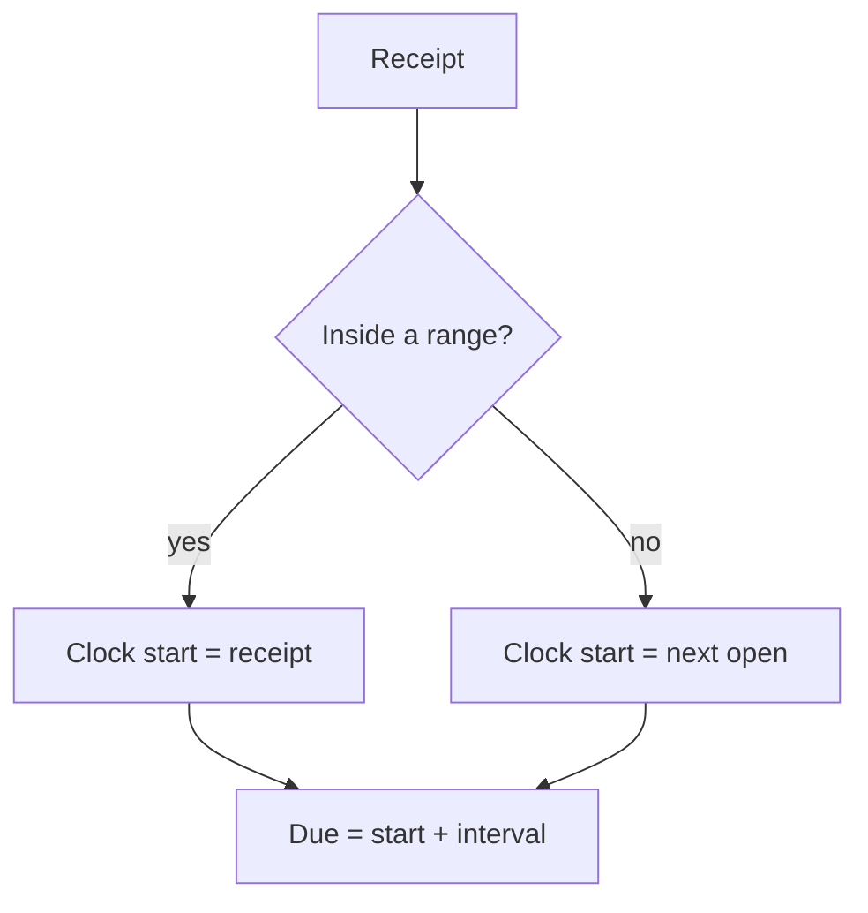

# Practice hours

How the clock uses open ranges. Configure them from the [Practice hours](../README.md#practice-hours) section of the README.

## Defaults

Monday to Friday, 08:00 to 20:00, Europe/London, with a 24-hour reply interval.

| Receipt | Clock start | Reply due |
| --- | --- | --- |
| Tuesday 10:00 | Tuesday 10:00 | Wednesday 10:00 |
| Thursday 21:00 | Friday 08:00 | Saturday 08:00 |
| Friday 21:00, or Saturday, or Sunday | Monday 08:00 | Tuesday 08:00 |

## Clock rules

A receipt inside a range starts the clock at the receipt. A receipt before the first range that day starts at that open. A receipt in a gap, after the last range, or on a closed day starts at the next open: the next range later that day, or the first range on a later day that has one.

The reply is due the interval after the clock start. That due time is not pulled back into a range. Under the default, Thursday 21:00 is still due on Saturday 08:00.

Replied in counts from the clock start, and only inside the configured ranges. Time outside those ranges is not part of that figure.

When the signed-in user opens the panel outside those ranges, a banner names the next open. It does not block the queue.

## Timezone on notes

One setting supplies the zone used to calculate the clock, to write a note, and to show a time. The note header names that zone. Notes already stored name Europe/London, and the reader still accepts that name, or any other valid zone name on the line.

## Refused settings

A week with no ranges at all, a range whose close is before its open, overlapping ranges on the same day, an interval below one hour, or an unknown timezone is refused. The desk does not guess a window.
